# Open-Power dev map

Copy of the visual map on [Map: 10–100 kHz loss campaign to a validated Eoff on Zenodo](https://github.com/luizvilla/test_bench_code/issues/1), the canonical one. Redrawn by `python3 tools/devmap/devmap.py` whenever a ticket opens, closes, is claimed or goes stale.

**Destination:** a validated loss model of the opposition bench (P_remaining(f) over 10–100 kHz at 60 V / 3.5 A / 300 ns, Eoff, the fixed term characterised), published as a new version of the Zenodo dataset.

```mermaid
flowchart LR
  classDef done fill:#d3f9d8,stroke:#2b8a3e,color:#1b4332
  classDef open fill:#d0ebff,stroke:#1c7ed6,color:#0b3d6e
  classDef blocked fill:#ffe8cc,stroke:#e8590c,color:#5c2b00
  classDef wip fill:#f3d9fa,stroke:#ae3ec9,color:#4a1259
  classDef stale fill:#ffe3e3,stroke:#e03131,color:#5c0a0a,stroke-width:3px
  classDef fog fill:#f1f3f5,stroke:#868e96,color:#495057,stroke-dasharray:5 5
  classDef out fill:#fff,stroke:#adb5bd,color:#868e96,stroke-dasharray:2 2
  classDef dest fill:#343a40,stroke:#000,color:#fff,font-weight:bold

  DEST(["🎯 Validated Eoff and fixed-loss model,<br/>10–100 kHz, new Zenodo version"]):::dest

  subgraph Before["Done before the map"]
    D1["✓ 16 Sept session, 50/60/70 kHz<br/>loss-breakdown Excel"]:::done
    D2["✓ OnlyScripts supervisor<br/>(Maxime)"]:::done
    D3["✓ Period-synced start/stop<br/>DMA sequences (Core)"]:::done
  end

  subgraph Tonight["Ready for 27 November"]
    N2["✓ #2 Bench core<br/>power_tuesday-v2"]:::done
    N3["🔨 #3 Bench app on new core<br/>firmware/"]:::wip
    N5["✓ #5 ThingSet migration?"]:::done
    N6["👤 #6 ThingSet: now,<br/>later or not?"]:::open
    N4["🔨 #4 Phase reduction<br/>and stop fix"]:::blocked
    N7["🔨 #7 Fractional phase<br/>(float °)"]:::blocked
    N8["🔨 #8 Dead-time duty<br/>compensation"]:::blocked
    N9["✓ #9 Sweep configs<br/>10–100 kHz + anchors"]:::done
    N11["✓ #11 Processing script<br/>= Excel"]:::done
    N10["🔨 #10 SPOC dry run<br/>of the sweep"]:::blocked
    N12["👤 #12 Session plan<br/>27 Nov"]:::blocked
  end

  subgraph After["After the session"]
    N15["👤 #15 16 Sept raw data<br/>through the script"]:::open
    N13["👤 #13 Record the<br/>27 Nov results"]:::blocked
    N14["👤 #14 P_remaining(f)<br/>linear 10–100 kHz?"]:::blocked
    FG["fixed-term grid<br/>Vbus × dead time × Ipeak"]:::fog
    FC["capacitor vs<br/>frequency window"]:::fog
    FS["sim vs bench<br/>(upstream #10, #13)"]:::fog
    FT["ThingSet migration"]:::fog
    FU["upstream PRs<br/>bench + core"]:::fog
    FZ["Zenodo new version<br/>data + script + note"]:::fog
  end

  subgraph Out["Out of scope"]
    O1["paper"]:::out
    O2["Zephyr 4.4.2 bump<br/>(code/Core)"]:::out
    O3["Safety API PR<br/>(code/Core2)"]:::out
  end

  N2 --> N3
  N3 --> N4
  N3 --> N7
  N3 --> N8
  N5 --> N6
  N6 --> N7
  N6 --> N8
  N4 --> N10
  N7 --> N10
  N8 --> N10
  N9 --> N10
  N11 --> N12
  N10 --> N12
  N12 --> N13
  N15 --> N14
  N13 --> N14
  D3 --> N2
  D2 --> N9
  D1 --> N11
  N6 -.-> FT
  N11 -.-> FS
  N14 -.-> FG
  N14 -.-> FC
  N10 -.-> FU
  FG -.-> FZ
  FS -.-> FZ
  N14 --> FZ
  FZ -.-> DEST
```

<!-- devmap:diagram:start -->

Green done · blue takeable · purple in progress · orange blocked · red ⏳ stale (3 days without activity) · grey dashed fog · white dashed out of scope · 🔨 build · 🔎 research · 👤 can't move without Luiz.
<!-- devmap:diagram:end -->
